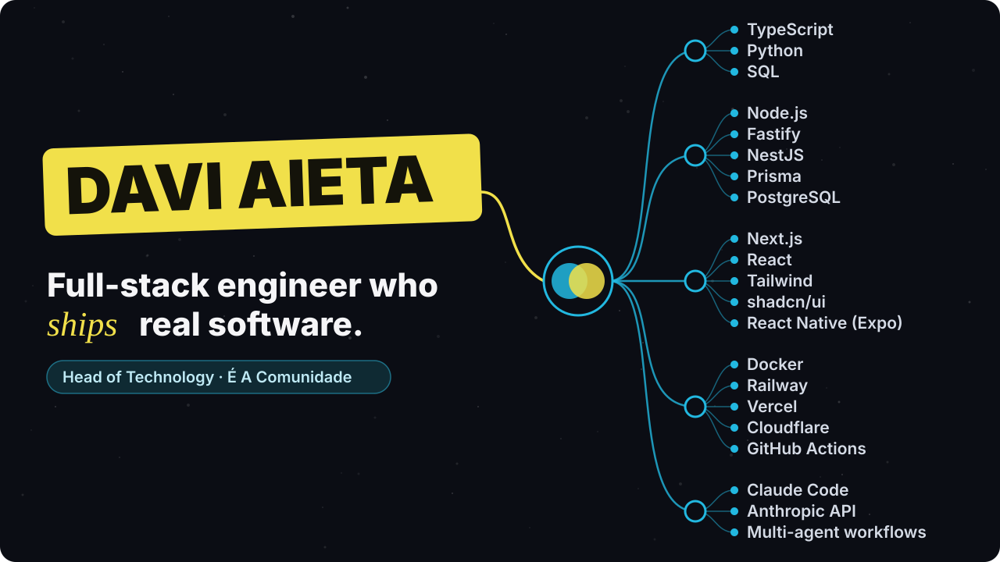

  

  🏠 <a href="https://eeacomunidade.com/"><b>É A Comunidade</b></a> &nbsp;·&nbsp;
  𝕏 <a href="https://x.com/daviaietaa"><b>@daviaietaa</b></a> &nbsp;·&nbsp;
  🗣️ Portuguese · English · Spanish

I've been writing code since I was 12, the hard way, before AI did the typing. Today I take products from an empty repo to real users, and I run technology at **[É A Comunidade](https://eeacomunidade.com/)**, a community of 700+ members.

## ⚡ What sets me apart

- 🏗️ **End to end, on my own.** Schema, API, web, mobile, infra and deploy. One person, one product, real users.
- 🗄️ **Correctness lives in the database.** Constraints, transactions and idempotency, not "it worked on my machine".
- 🤖 **AI-native, not AI-dependent.** I run agents in parallel and write every prompt, then I read the diff. I want to understand every line that ships.
- ✅ **Done means running.** In the browser and on the device, not just green in CI. Every decision is written down with the trade-off I accepted.

## 📍 Now · October 2026

- 🏠 **Leading technology at [É A Comunidade](https://eeacomunidade.com/).** Since September I own the technology pillar and answer the members' tech questions.
- 📱 **Shipping the community app** to web, iOS and Android, with one API behind all three.
- 📚 **Studying Python and AI engineering.**

## 🎥 Content

I make content about technology and AI on Instagram and YouTube: how I build software and use AI day to day, in public, mistakes included.

**Why I do it.** Not to sell a course, and not to make money off it. I believe it can open a lot of doors for me, and I want to make a real difference in people's lives with what I know about technology. If something I show helps someone build, learn or ship, that's the win.

## 🔓 Open source

**[jarvis](https://github.com/daviaieta/jarvis)**: a second brain in Obsidian + Claude Code, in three steps (pt-BR).

📈 **The Jarvis reel on Instagram is still growing.** So far:

  👁️ <b>8,195</b> views &nbsp;·&nbsp; ❤️ <b>272</b> likes &nbsp;·&nbsp; 💬 <b>100</b> comments &nbsp;·&nbsp; 🔁 <b>56</b> shares &nbsp;·&nbsp; 🔖 <b>43</b> saves 
  🌱 <b>76%</b> of the views came from people who don't follow me

